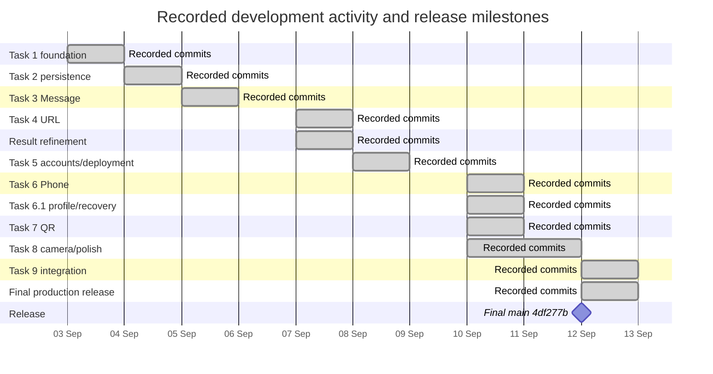

# Gantt chart and table equivalent

## Current proposal plan — evidence supplied 20 October 2026

The user-designated proposal PDF, pages 43–47 (Tables 13–14 and Figure 15), provides a planned 12-week period from **1 September to 20 November 2026**. Its dates must remain separate from the observed Git chronology below. Actual literature-review, study and rehearsal dates must come from real records.

| Planned milestone | Proposal date | Current evidence / qualification |
| --- | --- | --- |
| M1 proposal acceptance, end Week 2 | 11 September | Proposed checkpoint; signed approval not supplied. |
| M2 design review, Week 3 | 18 September | Design artifacts exist; exact supervisor review event not inferred. |
| M3 deployment, Week 7 | 16 October | September and October deployments are evidenced separately. |
| M4 feature freeze, start Week 10 | 2 November | Future planned checkpoint; no new feature phase authorized. |
| M5 report, Week 12 | By 18 November | Proposed submission date; official timetable governs. |
| M6 presentation, Week 12 | By 20 November | Proposed presentation date; official timetable and duration govern. |

Objective phases: O1 Weeks 1–3; O2 Weeks 2–3; O3 Weeks 3–9; O4 Weeks 9–11. The volunteer study is part of O4 and has not yet been conducted. A proposal date does not prove approval, on-time completion or labour duration.

## Historical Git chronology — September release

The chart represents recorded commit intervals from Table 10, not retrospective invented deadlines. Single-day entries use a one-day visual cell; zero-duration release is a milestone. Dates are 2026, Asia/Kuala_Lumpur. Bar endpoints are the dates printed in Table 10; they do not establish exact working hours.

**Figure 6. Recorded development chronology.** Source: Git commit timestamps; see PROJECT_PLAN.md and evidence/project-git-chronology.txt.

**Table 11. Report-friendly Gantt equivalent.** An X indicates a calendar date within the recorded interval, including its endpoints; a dash indicates no inference.

| Phase | Sep 03 | Sep 04 | Sep 05 | Sep 06 | Sep 07 | Sep 08 | Sep 09 | Sep 10 | Sep 11 | Sep 12 |
| --- | --- | --- | --- | --- | --- | --- | --- | --- | --- | --- |
| Task 1 foundation | X | X | - | - | - | - | - | - | - | - |
| Task 2 persistence | - | X | X | - | - | - | - | - | - | - |
| Task 3 Message | - | - | X | - | - | - | - | - | - | - |
| Task 4 URL | - | - | - | - | X | - | - | - | - | - |
| Result refinement | - | - | - | - | X | - | - | - | - | - |
| Task 5 accounts/deployment | - | - | - | - | - | X | X | - | - | - |
| Task 6 Phone | - | - | - | - | - | - | - | X | - | - |
| Task 6.1 profile/recovery | - | - | - | - | - | - | - | X | - | - |
| Task 7 QR | - | - | - | - | - | - | - | X | - | - |
| Task 8 camera/polish | - | - | - | - | - | - | - | X | X | X |
| Task 9 integration | - | - | - | - | - | - | - | - | - | X |
| Final production release | - | - | - | - | - | - | - | - | - | X |
